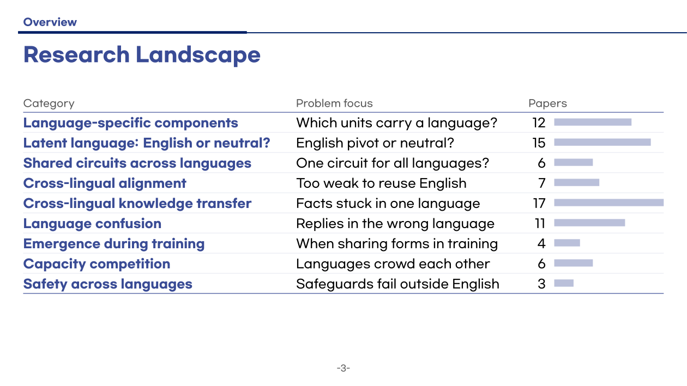
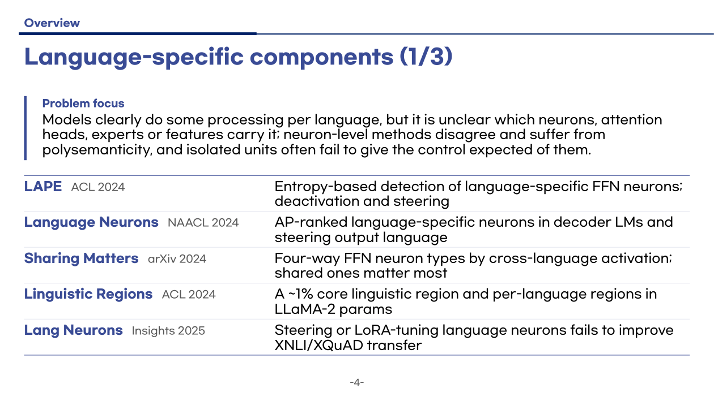
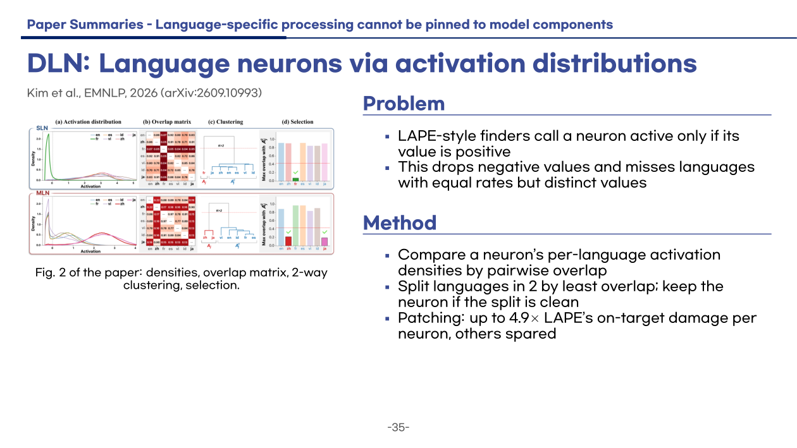
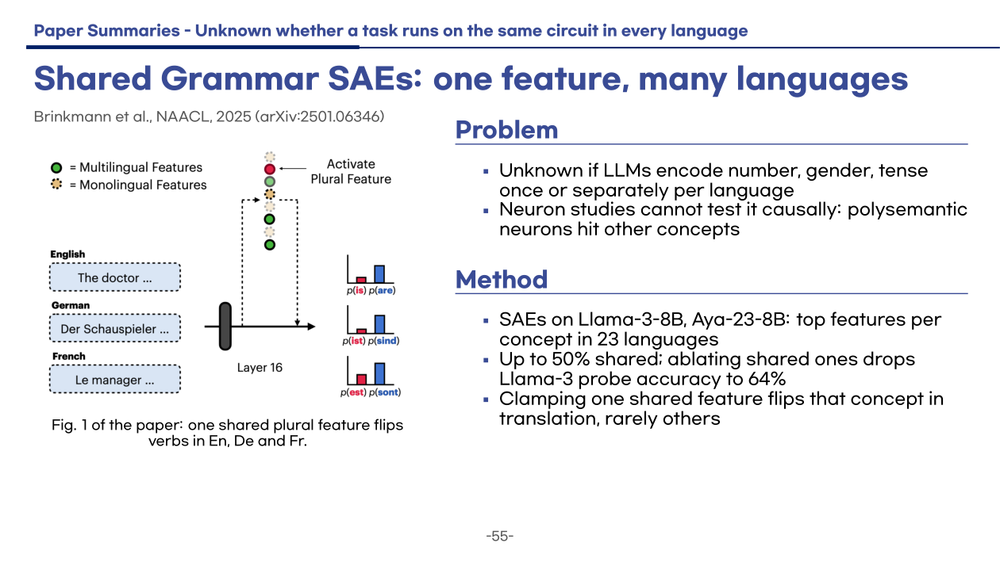

# Literature Review Pipeline

Claude Code skills that survey a research area you are new to: collect papers,
group them by the problem they address, download the PDFs, and build a Beamer
slide deck (landscape → one slide per paper → open problems).

| | |
| --- | --- |
|  |  |
|  |  |

Slides from a deck built by the pipeline: the research landscape, one category,
and two paper slides.

## Setup

Requires [uv](https://docs.astral.sh/uv/) and [Claude Code](https://claude.com/claude-code).
Clone once per research topic:

```bash
TOPIC=my-topic    # folder name for this review
git clone https://github.com/mjkmain/literature-review-pipeline.git $TOPIC
cd $TOPIC
./setup.sh        # .venv (PyMuPDF) + TinyTeX in ~/.TinyTeX; first run on a machine takes a few minutes, later ~1 s
claude
```

## Usage

Run everything at once (no questions in between, one report at the end):

```
/literature-review <research area> — years: 2023- — min: 30 [— korean]
```

Or run the steps one by one, checking each output. The skills run only when invoked.
Run `/clear` between steps: each step reads its input from the files the previous
one wrote, so it does not need the earlier conversation.

```
/literature-collector <research area> — years: 2023- — min: 30   # → reference/papers.md
/literature-categorizer                                          # → reference/index.md
/paper-index-downloader                                          # → reference/<category>/*.pdf
/literature-slide-writer                                         # → reference/summaries/, slide/<area>-literature/<area>_slide_en.pdf
/literature-slide-writer — korean                                # optional: <area>_slide_ko.pdf
```

Check each step's output before running the next. Step 4 runs one agent per
paper, about 60k tokens each, so try `min: 15` on a first run.

Rebuild a deck after editing it by hand:

```bash
cd slide/<area>-literature && make en     # or: make ko
```

## Layout

```
.claude/skills/                  # literature-review (runs all steps), one skill per step, paper-figure-extractor
slide/literature_review_template # Beamer template, copied for each deck
reference/                       # papers.md, index.md, summaries/ (one .md per paper), PDFs (git-ignored)
setup.sh, requirements.txt
```
